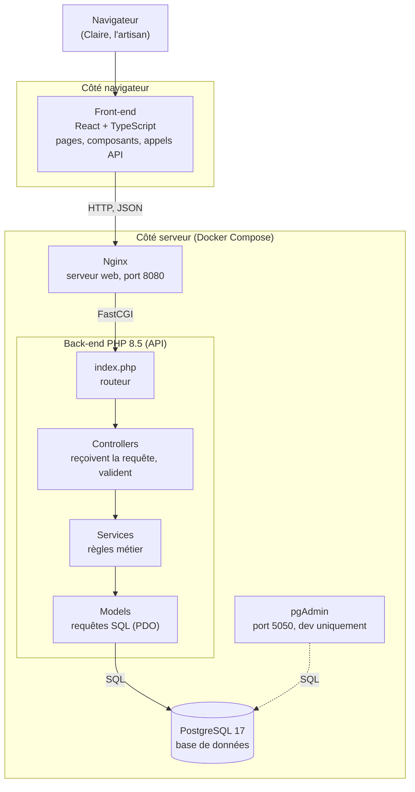

# Architecture de l'application

Projet Lovelace Céramique (Lovelace Factory, Arc 2, S5).

## 1. Schéma



## 2. Rôle de chaque composant

| Composant | Techno | Ce qu'il fait | Ce qu'il ne fait pas |
|---|---|---|---|
| Front-end | React + TypeScript | Affiche les commandes et les objets, envoie les actions de l'utilisateur à l'API | Il ne contient pas de règle métier et ne parle jamais directement à la base |
| Nginx | Nginx 1.27 | Reçoit toutes les requêtes et les envoie à `index.php` | Il ne contient pas de logique |
| Routeur | `index.php` | Regarde l'URL et appelle le bon controller | |
| Controllers | PHP | Lisent la requête, vérifient les données reçues, renvoient la réponse JSON avec le bon code HTTP | Pas de SQL |
| Services | PHP | Appliquent les règles de l'atelier (ordre des étapes, pertes, droits Admin / Contributeur) | Ils ne connaissent pas HTTP |
| Models | PHP + PDO | Lisent et écrivent dans PostgreSQL | Ils ne prennent pas de décision |
| Base de données | PostgreSQL 17 | Stocke les utilisateurs, commandes, objets, étapes, pertes | |
| pgAdmin | pgAdmin 4 | Permet de regarder la base pendant le développement | Pas utilisé en production |

## 3. Organisation des dossiers et nommage

Ce qui existe aujourd'hui et ce que nous prévoyons :

```
lovelace-ceramique/
├── index.php                 routeur (existe)
├── config/db.php             connexion PDO (existe)
├── backend/
│   ├── controllers/          HomeController.php... (existe)
│   ├── services/             CommandeService.php... (à venir)
│   └── models/               CommandeModel.php... (à venir)
├── frontend/                 application React (à venir)
├── docker/                   config Nginx, PHP, PostgreSQL (existe)
├── docker-compose.yml
├── ADR.md                    nos décisions
└── README.md
```

Conventions :

- Une classe par fichier, le fichier porte le nom de la classe (`CommandeController.php`).
- Suffixe selon le rôle : `...Controller`, `...Service`, `...Model`.
- Routes de l'API en minuscules et au pluriel : `/api/commandes`, `/api/objets`.
- Tables en minuscules, au pluriel, mots séparés par `_` : `commandes`, `objets`, `etapes`.
- Branches Git : `feature/`, `fix/`, `docs/`, `refactor/`, `chore/`. Commits au format Conventional Commits.

## 4. Pourquoi ces choix

Les détails sont dans `ADR.md`. En résumé :

- PostgreSQL : l'équipe le connaît déjà et il permet des requêtes avancées. MySQL et SQLite ont été écartés (SQLite gère mal plusieurs utilisateurs en même temps).
- React + TypeScript : l'équipe a de l'expérience dessus et le typage limite les erreurs. Angular a été écarté (personne ne le connaît), le JavaScript natif aussi (trop léger pour la taille du projet).
- PHP : notre formateur le connaît bien et peut nous accompagner. Il est aussi facile à héberger. C#, Java et Node ont été écartés.
- Docker Compose : toute l'équipe a le même environnement en une commande, quel que soit l'ordinateur.

## 5. Architecture du code back : MVC avec une couche Service

Le MVC classique (Model, View, Controller) ne prévoit pas de place pour les règles métier. Elles finissent souvent dans les controllers, qui deviennent trop gros. Nous ajoutons donc une couche Service entre le controller et le model.

Exemple : la règle « un objet déclaré perdu ne peut plus passer à l'étape suivante » sera écrite une seule fois, dans un service. Elle pourra servir à plusieurs routes et être testée sans lancer de requête HTTP.

Dans notre cas la « Vue » du MVC est la réponse JSON envoyée à React. Le back ne génère pas de pages HTML.

Alternatives écartées :

| Architecture | Pourquoi on ne l'a pas prise |
|---|---|
| MVC sans services | Les règles de l'atelier se retrouveraient éparpillées dans les controllers |
| Hexagonale | Beaucoup de fichiers et d'abstraction pour une V1 avec peu de domaines |
| Clean Architecture | Quatre niveaux, trop lourd pour la taille du projet |
| CQRS | Nous n'avons pas beaucoup plus de lectures que d'écritures |

## 6. Flux complet : créer une commande (US.7)

C'est l'équivalent de « créer un projet » dans notre application.

1. L'Admin remplit le formulaire « Nouvelle commande » dans React et valide.
2. React envoie `POST /api/commandes` avec les données en JSON.
3. Nginx reçoit la requête sur le port 8080 et la transmet à `index.php`.
4. Le routeur reconnaît la méthode et l'URL, il appelle `CommandeController`.
5. On vérifie que l'utilisateur est connecté (sinon 401) et qu'il est Admin (sinon 403).
6. Le controller vérifie les données : nom présent, date valide (sinon 422).
7. `CommandeService` applique les règles métier (par exemple, une échéance ne peut pas être dans le passé).
8. `CommandeModel` fait l'`INSERT INTO commandes` avec une requête préparée (protection contre l'injection SQL).
9. L'API renvoie `201 Created` et la commande créée en JSON.
10. React ajoute la commande à la liste affichée.

Si PostgreSQL ne répond pas, l'API renvoie `500` avec un message d'erreur en JSON.

## 7. Ce qui n'est pas encore décidé

- L'authentification : session PHP (cookie) ou jeton JWT. Nous en ferons un ADR.
- Le dossier `frontend/` n'est pas encore créé dans le dépôt.
